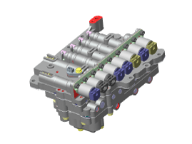

# Kia Sportage: Corpo de Valvulas: Descrição e Operação

[Home](../../index.md) / [Manual de Serviço e Reparo do Kia Sportage SL](../sportage-482.md) / [Sistema Transaxle Automático](sportage-683.md) / [Sistema Hidráulico](sportage-690.md) / Corpo de Valvulas: Descrição e Operação

## Descrição

O corpo de valvulas é essencial para o controle do transaxle automático
e consiste em várias valvulas usadas para controlar a alimentação de óleo do
pompa de óleo. Especificamente, essas valvulas consistem em valvulas reguladoras de pressão,
valvulas de redirecionamento de óleo, valvulas de engatamento, e valvulas manuais. O corpo também
possui valvulas solenoides eletrônicas que asseguram trocas de marcha suaves.

