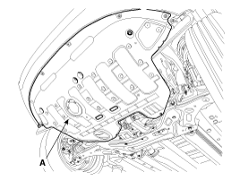
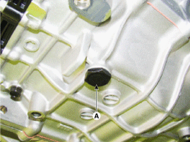
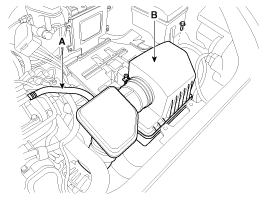
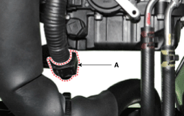
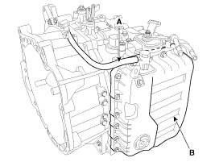
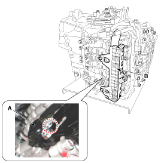
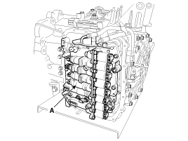

# Kia Sportage: Corpo do Válvula: Procedimentos de Reparo

[Home](../../index.md) / [Manual de Serviço e Reparo do Kia Sportage SL](../sportage-482.md) / [Sistema de Transaxle Automático](sportage-683.md) / [Sistema Hidráulico](sportage-690.md) / Procedimentos de Reparo do Corpo do Válvula

## Remoção

1. Remova o cobrebaixo (A).

   ```
   Torque de aperto:
   19,6 ~ 24,5 N.m (2,0 ~ 2,5 kgf.m, 14,5 ~ 18,1 lb-ft)
   ```

   

2. Remova o bucho de descarga (A) e derrame totalmente a ATF e, em seguida, reinstale o bucho de descarga.

   ```
   Torque de aperto:
   33,3 ~ 43,1 N.m (3,4 ~ 4,4 kgf.m, 24,6 ~ 31,8 lb-ft)
   ```

   

   > **Nota**
   >
   > - Deve ser substituído por um novo selo na instalação do bucho de descarga.

3. Remova o dutamento de ar (A).

   

4. Remova a montagem do filtro de ar.

   ```
   Torque de aperto
   Parafuso do cinto de mangote:
   2,9 ~ 4,9 N.m (0,3 ~ 0,5 kgf.m, 2,2 ~ 3,6 lb-ft)
   Parafusos da montagem do filtro de ar:
   7,8 ~ 9,8 N.m (0,8 ~ 1,0 kgf.m, 5,8 ~ 7,2 lb-ft)
   ```

   

5. Desconecte o gancho (A) do cobre do corpo do válvula.

   

6. Remova o mangote do respirador de ar (A).

7. Remova o corpo do válvula (B).

   ```
   Torque de aperto:
   13,7 ~ 15,7 N.m (1,4 ~ 1,6 kgf.m, 10,1 ~ 11,6 lb-ft)
   ```

   

8. Remova a conexão do válvula solenóide (B) e o sensor de temperatura do óleo (A).

   

9. Remova a montagem do corpo do válvula (A).

   ```
   Torque de aperto:
   9,8 ~ 11,8 N.m (1,0 ~ 1,2 kgf.m, 7,2 ~ 8,7 lb-ft)
   ```

   

## Instalação

1. Instale na ordem inversa da remoção.

   > **Nota**
   >
   > - Adicione a Liquidação do Transaxle Automático (ATF).
   > - (Consulte "Liquidação" no Sistema Hidráulico deste grupo)
   > - Realize o aprendizado do Modulo de Controle do Transaxle (TCM) após
   substituir o corpo do válvula para prevenir uma resposta lenta do transaxle, aceleração áspera e arranque áspero.
   > - (Consulte "Procedimentos de Reparo" no Sistema de Controle do Transaxle Automático deste grupo)
   > - Use um novo selo do corpo do válvula (A).
