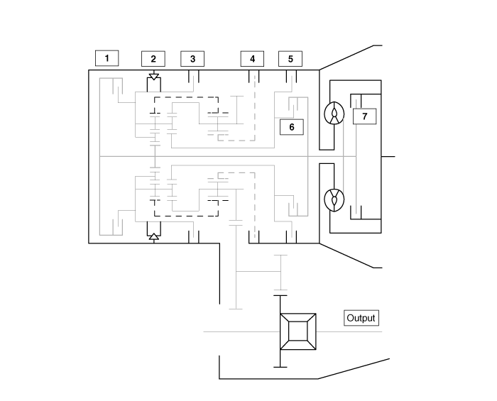

# Freio e Travacamento — Componentes e localização

[Home](../../index.md) / [Manual de Serviço e Reparo](../sportage-482.md) / [Sistema de Transaxle Automático](sportage-683.md) / [Freio e Travacamento](sportage-700.md) / Componentes e localização

## Diagrama

## Legenda

| Nº | Componente |
| --- | --- |
| 1 | Travacamento de Overdrive (OD/C) |
| 2 | Travacamento de Uma Direção (OWC) |
| 3 | Freio de Baixo & Reversa (LR/B) |
| 4 | Freio de Travacamento de Baixo (UD/B) |
| 5 | Freio 26 (26/B) |
| 6 | Travacamento 35R (35R/C) |
| 7 | Travacamento Amortecedor (D/C) |
