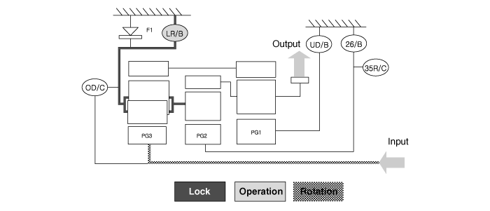
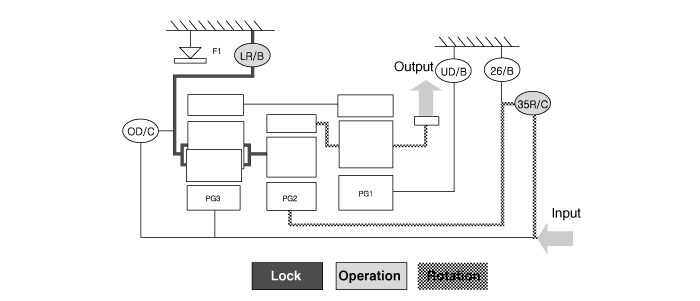
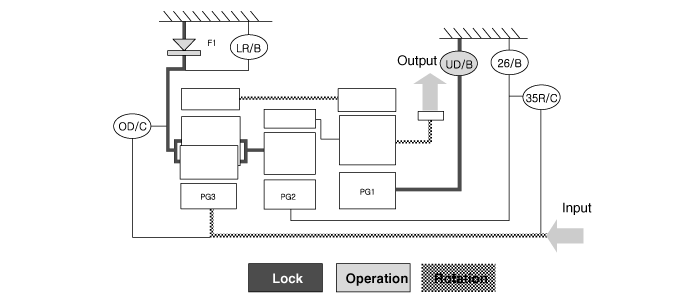
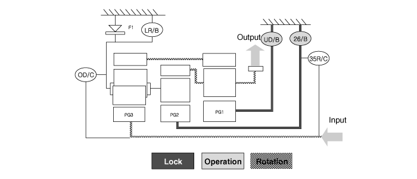
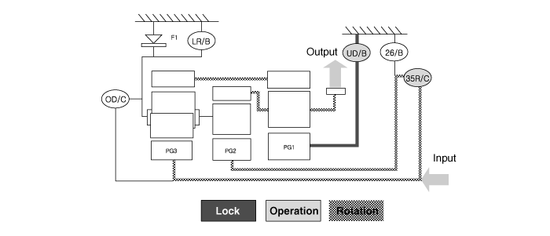
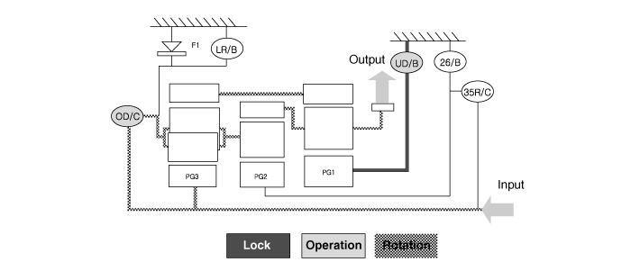
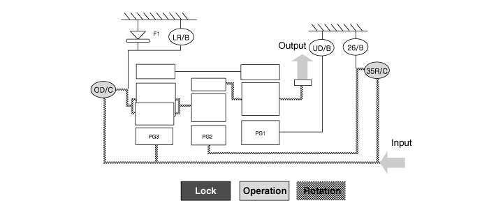
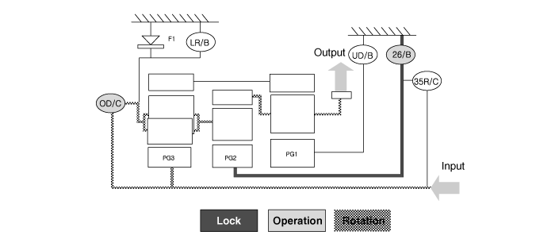

# Kia Sportage: Diagrama de Fluxo

[Início](../../index.md) / [Manual de Serviço e Reparo do Kia Sportage SL](../sportage-482.md) / [Sistema da Transaxle Automática](sportage-683.md) / [Freio e Travamento](sportage-700.md) / Diagrama de Fluxo

## Diagrama de Fluxo de Potência

| P,N | UD/B | LR/B | 26/B | 35R/C | OD/C | OWC |
| --- | --- | --- | --- | --- | --- | --- |
|  | ? |  |  |  |  |  |

? Direção de Rotação

?Ativação do Freio de Freio e Traseiro (LR/B) > Bloqueio do Eixo de Marcha Avançada (OD/C) > Bloqueio das Caixas de Marcha do Meio e Traseira (26/B)

?Rotação do Eixo de Entrada > Rotação do Dente de Sol da Lua Traseira > Rotação do Dente de Pinão Interno Traseiro (Reverso) > Rotação do Dente de Pinão Externo Traseiro > Rotação do Dente de Lua Externo Traseiro > Rotação do Dente de Sol da Lua Anterior > Rotação do Dente de Pinão Anterior (Reverso) > Rotação do Eixo de Marcha Avançada (UD/B) (Reverso)

?Rotação do Eixo de Entrada > Retenção do Cofre de Marcha Avançada (OD/C)

?Rotação do Eixo de Entrada > Rotação do Cofre de Marcha Avançada (35R/C)

| R | UD/B | LR/B | 26/B | 35R/C | OD/C | OWC |
| --- | --- | --- | --- | --- | --- | --- |
|  | ? |  | ? |  |  |  |

? Rotação de Potência

? Caixa de Marcha do Meio Bloqueada e Dente de Sol do Meio em Rotação

? Ao rotacionar o dente de sol da caixa de marcha do meio, enquanto seu eixo é bloqueado, a rotação é reduzida e reversa no dente de lua da frente (eixo de carregamento da frente), resultando na transferência de potência para o eixo de carregamento da frente.

? Os dentes de lua da caixa de marcha traseira rodam a uma velocidade reduzida, resultando em uma rotação reversa, sem carga, do dente de sol da caixa de marcha do meio.

| D1 | UD/B | LR/B | 26/B | 35R/C | OD/C | OWC |
| --- | --- | --- | --- | --- | --- | --- |
| ? | (0) |  |  |  | ? |  |

? Rotação de Potência

? Dente de Sol da Frente e Caixas de Marcha do Meio e Traseira Bloqueadas e Dente de Sol da Traseira em Rotação Constante

? Ao rotacionar o dente de sol da traseira, a potência é reduzida na caixa de marcha traseira e então transferida para as caixas de marcha do meio e da frente e o dente de sol da caixa de marcha da frente. A potência é então reduzida novamente na caixa de marcha da frente, cujo dente de sol está bloqueado, e então transferida para o eixo de carregamento da frente.

? Aqui, o dente de lua do meio, que faz parte de uma unidade com o eixo de carregamento da frente, roda e resulta em uma rotação reversa, sem carga, do dente de sol do meio.

| D2 | UD/B | LR/B | 26/B | 35R/C | OD/C | OWC |
| --- | --- | --- | --- | --- | --- | --- |
| ? |  | ? |  |  |  |  |

? Rotação de Potência

? Dente de Sol da Frente e Dente de Sol do Meio Bloqueados e Dente de Sol da Traseira em Rotação Constante

? Ao rotacionar o dente de sol da traseira, a potência é transferida para os dentes de lua da traseira e da frente e a reação do eixo de carregamento da frente e do dente de lua do meio, ao qual o dente de sol está ligado, é transferida para os eixos de carregamento do meio e da traseira, resultando em equilíbrio de potência e transferência de potência para o eixo de carregamento da frente.

| D3 | UD/B | LR/B | 26/B | 35R/C | OD/C | OWC |
| --- | --- | --- | --- | --- | --- | --- |
| ? |  |  | ? |  |  |  |

? Rotação de Potência

? Dente de Sol da Frente Bloqueado e Dentes de Sol do Meio e Traseira em Rotação

? Ao rotacionar o dente de sol do meio e o dente de sol da traseira, a potência é transferida para os dentes de lua da traseira e da frente, e a reação do eixo de carregamento da frente e do dente de sol do meio, ao qual o dente de sol está ligado, é transferida para os eixos de carregamento do meio e da traseira, resultando em equilíbrio de potência e transferência de potência para o eixo de carregamento da frente.

a carregador frontal e ao anel intermediário, ao qual está fixada a roda solares, são transferidos para os carregadores intermediário e traseiro, resultando em equilíbrio de potência e transferência de potência para o carregador frontal.

| D4 | UD/B | LR/B | 26/B | 35R/C | OD/C | OWC |
| --- | --- | --- | --- | --- | --- | --- |
| ? |  |  |  | ? |  |  |

? Caminho de Transmissão de Potência

? A roda solares da frente bloqueada e os carregadores traseiro e a roda solares traseira em rotação

? A ativação do embreagem de sobretransmissão (OD/C) sincroniza
as roda solares e o carregador do anel intermediário das engrenagens planetárias traseiras. A rotação em 1:1 passa pelos anéis intermediário e frontal e chega ao carregador frontal das engrenagens planetárias, ao qual está fixada a roda solares.

? Aqui, a roda solares do anel intermediário rota-se a uma velocidade mais rápida no sentido normal e com zero carga devido
à ação do anel intermediário reduzido e do carregador com rotação em 1:1.

| D5 | UD/B | LR/B | 26/B | 35R/C | OD/C | OWC |
| --- | --- | --- | --- | --- | --- | --- |
|  |  |  | ? | ? |  |  |

? Caminho de Transmissão de Potência

? Os carregadores intermediário e traseiro, a roda solares intermediária e a roda solares traseira em rotação

? O carregador do anel intermediário e a roda solares do anel intermediário rotam simultaneamente, resultando na transferência da rotação em 1:1 para o anel intermediário (carregador frontal).

? Aqui, o carregador do anel traseiro rota-se em 1:1, como se o 4º marcha estivesse engatada; no entanto, o carregador do anel frontal permanece inrestrito e a roda solares frontal rota-se no sentido normal, com zero carga e em rotação em 1:1.

| D6 | UD/B | LR/B | 26/B | 35R/C | OD/C | OWC |
| --- | --- | --- | --- | --- | --- | --- |
|  |  | ? |  | ? |  |  |

? Caminho de Transmissão de Potência

? Carregador intermediário em rotação e roda solares intermediária bloqueada

? Quando a roda solares do anel intermediário é bloqueada em seu lugar e o carregador do conjunto é permitido rotação, o anel intermediário aumenta sua velocidade de rotação e transmite potência para o carregador frontal.

? Aqui, o carregador do anel traseiro mantém a rotação em 1:1, como se a 4ª ou 5ª marcha estivesse engatada; no entanto, o carregador do anel frontal permanece inrestrito e a roda solares frontal rota-se a uma velocidade mais rápida no sentido normal e com zero carga.
