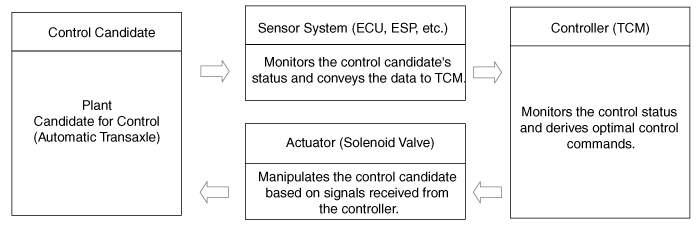

# Kia Sportage: Descrição e Operação

[Home](../../index.md) / [Manual de Serviço e Reparo do Kia Sportage SL](../sportage-482.md) / [Sistema de Transaxle Automático](sportage-683.md) / [Sistema de Controle do Transaxle Automático](sportage-704.md) / Descrição e Operação

## Descrição

O sistema de transaxle automático depende de diversos dados de medição para determinar o status de controle atual e extrapolar os valores de compensação necessários. Esses valores são utilizados para controlar os atuadores e alcançar a saída de controle desejada. Se um problema com o trenseção, incluindo o transaxle, foi identificado, realize a auto-diagnóstico e a inspeção básica do transaxle (inspeção de óleo e fluidos) e, em seguida, verifique os componentes do sistema de controle usando a ferramenta de diagnóstico.

## Composição do Sistema de Controle

Diagnóstico de Falhas

Possui um mecanismo de segurança que evita situações perigosas em caso de falha no transmissão. O modo de regressão é ativado se a transmissão falhar. Nesse modo, a transmissão opera em um nível funcional mínimo, permitindo que o veículo chegue a um centro de serviço.

**Segurança:** Evita situações perigosas em caso de falha.

**Regressão:** Mantém um nível funcional mínimo (*) em caso de falha, permitindo que o veículo chegue a um centro de serviço.

(*) Nível Funcional Mínimo: Marcha (configuração de engrenagem fixa), Ré e Neutro

Diagnóstico Autônomo

O TCM mantém uma comunicação contínua com os componentes do sistema de controle (sensores e solenóides). Se uma sinalização anormal for recebida por um período maior do que o definido, o TCM reconhece uma falha, armazena o código de falha na memória e, em seguida, envia um sinal de falha através do terminal de diagnóstico autônomo. Esses códigos de falha são armazenados de forma independente e não serão apagados mesmo que o interruptor de ignição seja desligado, a bateria seja desconectada ou o conectador do TCM seja desconectado.

> **Cuidado**
>
> - Desconectar um conector de sensor ou atuador enquanto o interruptor de ignição estiver na posição "Ligado" gera um código de falha diagnóstico (DTC) e o código é armazenado na memória. Nesse caso, desligar a bateria não apagará a memória de diagnóstico. Um ferramenta de diagnóstico deve ser usada para apagar a memória de diagnóstico.

> **Cuidado**
>
> - Antes de remover ou instalar qualquer parte, leia os códigos de falha diagnóstico e, em seguida, desconecte o terminal negativo (-) da bateria.
> - Antes de desconectar o cabo do terminal da bateria, desligue o interruptor de ignição. Remoção ou conexão do cabo da bateria durante a operação do motor ou com o interruptor de ignição ligado pode causar danos ao TCM.
> - Ao verificar o gerador para o estado de carregamento, não desconecte o terminal positivo da bateria para prevenir o dano ao ECM devido à tensão.
> - Ao carregar a bateria com um carregador externo, desconecte os terminais da bateria do veículo para prevenir o dano ao TCM.

Procedimento de Verificação (Diagnóstico Autônomo)

> **Cuidado**
>
> - Quando a tensão da bateria estiver muito baixa, os códigos de falha diagnóstico não podem ser lidos. Certifique-se de verificar a bateria e o sistema de carregamento antes de iniciar a testagem.
> - A memória de diagnóstico é apagada se a bateria ou o conectador do TCM for desconectado. Não desconecte a bateria antes de ler e registrar completamente os códigos de falha diagnóstico (DTC).

Procedimento de Inspeção (Usando o GDS)

1. Desligue o interruptor de ignição.

2. Conecte o GDS ao conectador de dados na placa de impacto inferior.

3. Ligue o interruptor de ignição.

4. Use o GDS para verificar o código de falha diagnóstico.

5. Repare a parte defeituosa conforme o mapa de diagnóstico.

6. Apague o código de falha diagnóstico.

7. Desconecte o GDS.

> **Cuidado**

> - Realize o aprendizado do TCM após a substituição da transmissão automática para prevenir resposta lenta da transmissão automática, aceleração intermitente e arranque intermitente. (Consulte o "Sistema de controle da transmissão automática (Procedimentos de reparo)" neste grupo)
> - Adicione fluido da transmissão automática. (Consulte o "Sistema hidráulico (Fluido)" neste grupo)
> - Após a manutenção da transmissão automática ou TCM, limpe o código de falha diagnosticada (DTC) usando a ferramenta GDS. Os códigos de falha diagnosticados (DTC) não podem ser limpos desconectando a bateria.
