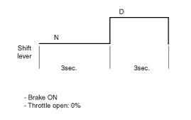

# Kia Sportage: Procedimentos de Reparo

[Home](../../index.md) / [Manual de Serviço e Reparo do Kia Sportage SL](../sportage-482.md) / [Sistema de Transaxle Automático](sportage-683.md) / [Sistema de Controle de Transaxle](sportage-704.md) / Procedimentos de Reparo

## Ajuste

Aprendizado do CMT

Quando ocorrer choque na troca de marcha ou quando peças relacionadas com o transaxle forem substituídas, deve ser realizado o aprendizado do CMT.

Em caso de:

| • | Substituição da caixa de transmissão |
| --- | --- |

| • | Substituição do CMT |
| --- | --- |

| • | Atualização do CMT |
| --- | --- |

1. Condições de aprendizado do CMT

   | – | Temperatura do ATF: 60~115°C (140~239°F) |
   | --- | --- |

2. Procedimento de aprendizado do CMT

   A. Parar o aprendizado

    Repita o seguinte padrão de troca de marcha quatro vezes ou mais, pisando no freio.

    

   B. Aprendizado de condução

   | 1) | Dirija o veículo em todas as marchas no modo D. Dirija de
   parado para 1ª para 2ª para 3ª para 4ª para 5ª para 6ª, mantendo o acelerador aberto fixo. |
   | --- | --- |

   | 2) | Desça de 6ª para 5ª, 5ª para 4ª, 4ª para 3ª, 3ª para 2ª, 2ª para 1ª. |
   | --- | --- |

   | 3) | Repita o padrão de condução acima quatro vezes ou mais. Abertura do acelerador na subida: 15~30% |
   | --- | --- |
