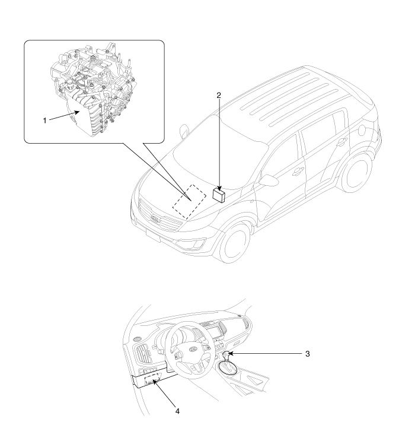
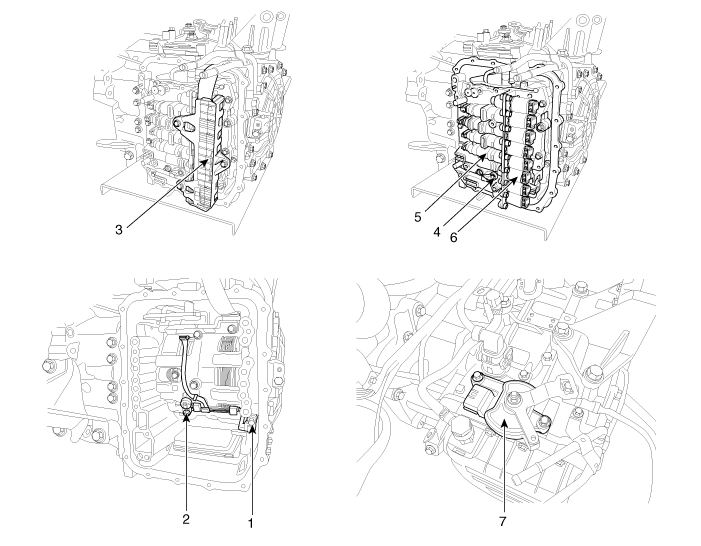

# Sistema de Controle do Transaxle Automático — Componentes e localização

[Home](../../index.md) / [Manual de Serviço e Reparo](../sportage-482.md) / [Sistema de Transaxle Automático](sportage-683.md) / [Sistema de Controle do Transaxle Automático](sportage-704.md) / Componentes e localização

## Diagrama — Localização

## Legenda — Localização

| Nº | Componente |
| --- | --- |
| 1 | Transaxle automático |
| 2 | Módulo de controle do transaxle (MCT) |
| 3 | Manivela de troca de marchas |
| 4 | DLC |

[Componentes do Veículo]

[Componentes do Transaxle]

## Diagrama — Localização

## Legenda — Localização

| Nº | Componente |
| --- | --- |
| 1 | Sensor de velocidade de entrada |
| 2 | Sensor de velocidade de saída |
| 3 | Conector do válvula solenoidal |
| 4 | Sensor de temperatura do óleo |
| 5 | Montagem da válvula corpo |
| 6 | Válvula solenoidal |
| 7 | Interruptor de inibidor |
