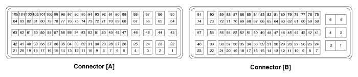

# Kia Sportage: Módulo de Controle da Transaxle (MCT): Diagramas Schematicos

[Home](../../index.md) / [Manual de Serviço e Reparo do Kia Sportage SL](../sportage-482.md) / [Sistema de Transaxle Automático](sportage-683.md) / [Sistema de Controle da Transaxle Automático](sportage-704.md) / Módulo de Controle da Transaxle (MCT): Diagramas Schematicos

## 1. Função das Conexões e Terminais do MCT

## 2. Função dos Terminais do MCT

Conector [A]

| Pin | Descrição | Pin | Descrição |
| --- | --- | --- | --- |
| 1 | ? | 54 | ? |
| 2 | Valvula de Válvula de Controle de Pressão de Linha (LINE_VFS) | 55 | ? |
| 3 | Valvula de Controle de Torretes (T/CON_VFS) | 56 | ? |
| 4 | Valvula de Controle do Clutch 35R (35R/C_VFS) | 57 | ? |
| 5 | ? | 58 | ? |
| 6 | ? | 59 | ? |
| 7 | Sinal do Interruptor de Inhibidor "S1" | 60 | ? |
| 8 | Sinal do Interruptor de Inhibidor "S2" | 61 | ? |
| 9 | Sinal do Interruptor de Inhibidor "S3" | 62 | ? |
| 10 | Sinal do Interruptor de Inhibidor "S4" | 63 | ? |
| 11 | ? | 64 | ? |
| 12 | ? | 65 | Valvula SS-B (ON/OFF) |
| 13 | ? | 66 | Valvula SS-A (ON/OFF) |
| 14 | ? | 67 | Bateria (B+) |
| 15 | ? | 68 | ? |
| 16 | ? | 69 | Sensor de Temperatura do Óleo (+) |
| 17 | ? | 70 | ? |
| 18 | ? | 71 | ? |
| 19 | ? | 72 | ? |
| 20 | ? | 73 | Sinal do Sensor de Velocidade de Saída |
| 21 | ? | 74 | Interruptor de Modo Desportivo Up |
| 22 | ? | 75 | ? |
| 23 | Valvula de Controle do Freio de Sub-Deslocamento (UD/B_VFS) | 76 | ? |
| 24 | Valvula de Controle do Freio 26 (26/B_VFS) | 77 | ? |
| 25 | Valvula de Controle do Clutch de Super-Deslocamento (OD/C_VFS) | 78 | ? |
| 26 | ? | 79 | ? |
| 27 | ? | 80 | ? |
| 28 | ? | 81 | ? |
| 29 | ? | 82 | ? |
| 30 | ? | 83 | ? |
| 31 | ? | 84 | ? |
| 32 | ? | 85 | ? |
| 33 | ? | 86 | Suprimento de Energia da Valvula 1 |
| 34 | ? | 87 | Suprimento de Energia da Valvula 2 |
| 35 | ? | 88 | Bateria (B+) |
| 36 | ? | 89 | ? |
| 37 | ? | 90 | Suprimento de Energia do Sensor de Velocidade de Saída |
| 38 | ? | 91 | Suprimento de Energia do Sensor de Velocidade de Entrada |
| 39 | ? | 92 | ? |
| 40 | ? | 93 | ? |
| 41 | ? | 94 | Sinal do Sensor de Velocidade de Entrada |
| 42 | ? | 95 | Interruptor de Modo Desportivo Down |
| 43 | ? | 96 | ? |
| 44 | Terreno (Poder 1) | 97 | ? |
| 45 | Terreno (Poder 2) | 98 | ? |
| 46 | Solenida do Bloqueio de Marcha | 99 | ? |
| 47 | ? | 100 | ? |
| 48 | Sensor de Temperatura do Óleo (-) | 101 | ? |
| 49 | ? | 102 | ? |
| 50 | ? | 103 | ? |
| 51 | ? | 104 | ? |
| 52 | Interruptor de Seleção de Modo Desportivo | 105 | ? |
| 53 | ? | ? | ? |

## 3. TCM Terminal de Entrada/Saída de Sinal

Conector [A]

| Pin | Descrição | Condição | Valor de entrada/saída |  |
| --- | --- | --- | --- | --- |
| Tipo | Nível |  |  |  |
| 1 | - | ? | ? | ? |
| 2 | Valvula de válvula de controle de pressão de linha (LINE_VFS) | ? | Saída | 0V/Voltagem da bateria |
| 9V < Voltagem da bateria < 16V |  |  |  |  |
| 3 | Valvula de controle do conversor torretal (T/CON_VFS) | ? | Saída | 0V/Voltagem da bateria |
| 9V < Voltagem da bateria < 16V |  |  |  |  |
| 4 | Valvula de controle do travamento do 35R (35R/C_VFS) | ? | Saída | 0V/Voltagem da bateria |
| 9V < Voltagem da bateria < 16V |  |  |  |  |
| 5 | - | ? | ? | ? |
| 6 | - | ? | ? | ? |
| 7 | Sinal do interruptor de travamento "S1" | Alto | Entrada | 0V/Voltagem da bateria |
| Baixo | 9V < Voltagem da bateria < 16V |  |  |  |
| 8 | Sinal do interruptor de travamento "S2" | Alto | Entrada | 0V/Voltagem da bateria |
| Baixo | 9V < Voltagem da bateria < 16V |  |  |  |
| 9 | Sinal do interruptor de travamento "S3" | Alto | Entrada | 0V/Voltagem da bateria |
| Baixo | 9V < Voltagem da bateria < 16V |  |  |  |
| 10 | Sinal do interruptor de travamento "S4" | Alto | Entrada | 0V/Voltagem da bateria |
| Baixo | 9V < Voltagem da bateria < 16V |  |  |  |
| 11 | - | ? | ? | ? |
| 12 | - | ? | ? | ? |
| 13 | - | ? | ? | ? |
| 14 | - | ? | ? | ? |
| 15 | - | ? | ? | ? |
| 16 | - | ? | ? | ? |
| 17 | - | ? | ? | ? |
| 18 | - | ? | ? | ? |
| 19 | - | ? | ? | ? |
| 20 | - | ? | ? | ? |
| 21 | - | ? | ? | ? |
| 22 | - | ? | ? | ? |
| 23 | Valvula de controle do freio de baixa velocidade (UD/B_VFS) | ? | Saída | 0V/Voltagem da bateria |
| 9V < Voltagem da bateria < 16V |  |  |  |  |
| Suprimento de energia: V_SOL2 |  |  |  |  |
| 24 | Valvula de controle do freio 26 (26/B_VFS) | ? | Saída | 0V/Voltagem da bateria |
| 9V < Voltagem da bateria < 16V |  |  |  |  |
| Suprimento de energia: V_SOL2 |  |  |  |  |
| 25 | Valvula de controle do travamento do overdrive (OD/C_VFS) | ? | Saída | 0V/Voltagem da bateria |
| 9V < Voltagem da bateria < 16V |  |  |  |  |
| Suprimento de energia: V_SOL1 |  |  |  |  |
| 26 | - | ? | ? | ? |
| 27 | - | ? | ? | ? |
| 28 | - | ? | ? | ? |
| 29 | - | ? | ? | ? |
| 30 | - | ? | ? | ? |
| 31 | - | ? | ? | ? |
| 32 | - | ? | ? | ? |
| 33 | - | ? | ? | ? |
| 34 | - | ? | ? | ? |
| 35 | - | ? | ? | ? |
| 36 | - | ? | ? | ? |
| 37 | - | ? | ? | ? |
| 38 | - | ? | ? | ? |
| 39 | - | ? | ? | ? |
| 40 | - | ? | ? | ? |
| 41 | - | ? | ? | ? |
| 42 | - | ? | ? | ? |
| 43 | - | ? | ? | ? |
| 44 | Terra (Poder 1) | ? | Terra | 0V |
| 45 | Terra (Poder 2) | ? | Terra | 0V |
| 46 | Solenoide de travamento da transmissão | Alto | Saída | 0V/Voltagem da bateria |
| Baixo | 9V < Voltagem da bateria < 16V |  |  |  |
| 47 | - | ? | ? | ? |
| 48 | Sensor de temperatura do óleo (-) | ? | Terra | 0V |
| 49 | - | ? | ? | ? |
| 50 | - | ? | ? | ? |
| 51 | - | ? | ? | ? |
| 52 | Interruptor de modo desportivo | Modo desportivo | Entrada | 0V/Voltagem da bateria |
| Outro | 9V < Voltagem da bateria < 16V |  |  |  |
| 53 | - | ? | ? | ? |
| 54 | - | ? | ? | ? |

| 55 | - | ? | ? | ? |
| 56 | - | ? | ? | ? |
| 57 | - | ? | ? | ? |
| 58 | - | ? | ? | ? |
| 59 | - | ? | ? | ? |
| 60 | - | ? | ? | ? |
| 61 | - | ? | ? | ? |
| 62 | - | ? | ? | ? |
| 63 | - | ? | ? | ? |
| 64 | - | ? | ? | ? |
| 65 | Válvula solenóide ON/OFF B (SS-B) | Alto | Saída | 0V/Nível da bateria |
| Baixo | 9V < Nível da bateria < 16V |  |  |  |
| 66 | Válvula solenóide ON/OFF A (SS-A) | Alto | Saída | 0V/Nível da bateria |
| Baixo | 9V < Nível da bateria < 16V |  |  |  |
| 67 | Poder da bateria (B+) | ON | Energia | 0V/Nível da bateria |
| OFF | 9V < Nível da bateria < 16V |  |  |  |
| 68 | - | ? | ? | ? |
| 69 | Sensor de temperatura do óleo (+) | ON | Entrada | 0V/3,3V |
| OFF |  |  |  |  |
| 70 | - | ? | ? | ? |
| 71 | - | ? | ? | ? |
| 72 | - | ? | ? | ? |
| 73 | Sinal do sensor de velocidade de saída | Alto | Entrada | 0,7V/1,4V |
| Baixo |  |  |  |  |
| 74 | Interruptor de modo desportivo para cima | ON para cima | Entrada | 0V/Nível da bateria |
| Outros | 9V < Nível da bateria < 16V |  |  |  |
| 75 | - | ? | ? | ? |
| 76 | - | ? | ? | ? |
| 77 | - | ? | ? | ? |
| 78 | - | ? | ? | ? |
| 79 | - | ? | ? | ? |
| 80 | - | ? | ? | ? |
| 81 | - | ? | ? | ? |
| 82 | - | ? | ? | ? |
| 83 | - | ? | ? | ? |
| 84 | - | ? | ? | ? |
| 85 | - | ? | ? | ? |
| 86 | Poder da válvula solenóide 1 | ON | Energia | 0V/Nível da bateria |
| OFF | 9V < Nível da bateria < 16V |  |  |  |
| 87 | Poder da válvula solenóide 2 | ON | Energia | 0V/Nível da bateria |
| OFF | 9V < Nível da bateria < 16V |  |  |  |
| 88 | Poder da bateria (B+) | ON | Energia | 0V/Nível da bateria |
| OFF | 9V < Nível da bateria < 16V |  |  |  |
| 89 | - | ? | ? | ? |
| 90 | Poder do sensor de velocidade de saída | ON | Energia | 0V/7,5V |
| OFF |  |  |  |  |
| 91 | Poder do sensor de velocidade de entrada | ON | Energia | 0V/7,5V |
| OFF |  |  |  |  |
| 92 | - | ? | ? | ? |
| 93 | - | ? | ? | ? |
| 94 | Sinal do sensor de velocidade de entrada | Alto | Entrada | 0,7V/1,4V |
| Baixo |  |  |  |  |
| 95 | Interruptor de modo desportivo para baixo | ON para baixo | Entrada | 0V/Nível da bateria |
| Outros | 9V < Nível da bateria < 16V |  |  |  |
| 96 | - | ? | ? | ? |
| 97 | - | ? | ? | ? |
| 98 | - | ? | ? | ? |
| 99 | - | ? | ? | ? |
| 100 | - | ? | ? | ? |
| 101 | - | ? | ? | ? |
| 102 | - | ? | ? | ? |
| 103 | - | ? | ? | ? |
| 104 | - | ? | ? | ? |
| 105 | - | ? | ? | ? |
