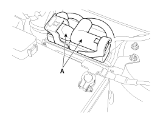
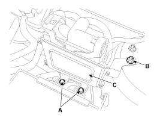

# Kia Sportage: Modulo de Controle da Transaxila (MCT): Procedimentos de Reparo

[Home](../../index.md) / [Manual de Serviço e Reparo do Kia Sportage SL](../sportage-482.md) / [Sistema de Transaxila Automática](sportage-683.md) / [Sistema de Controle da Transaxila Automática](sportage-704.md) / Procedimentos de Reparo do Modulo de Controle da Transaxila (MCT)

## Inspeção

Procedimento de Inspeção do MCT

1. TESTAR CIRCUITO DE CHÃO DO MCT: Medir a resistência entre o MCT e o chassi de chão usando o conector traseiro do harness do MCT como ponto de verificação do lado do MCT. Se o problema for encontrado, realize a reparação.

   ```
   Especificação: Menor que 1?
   ```

2. TESTAR CONECTOR DO MCT: Desconecte o conector do MCT e verifique visualmente os terminais de chão do lado do MCT e do lado do harness para pinos torcidos ou pressão de contato ruim. Se o problema for encontrado, realize a reparação.

3. Se o problema não for encontrado nos passos 1 e 2, o MCT pode estar defeituoso. Se for o caso, certifique-se de que não houvessem DTCs antes de trocar o MCT por um novo, e então verifique o veículo novamente. Se DTCs foram encontrados, examine isso primeiro antes de trocar o MCT.

4. RE-TESTAR O MCT ORIGINAL: Instale o MCT original (pode estar quebrado) em um veículo conhecido como bom e verifique o veículo. Se o problema ocorrer novamente, substitua o MCT original por um novo. Se o problema não ocorrer, este é um problema intermitente.

## Remoção

1. Desligue o interruptor de ignição e desconecte o cabo negativo (-) da bateria.

2. Desconecte o conector do ECM (A).

   

3. Remova a bateria.

   (Consulte o "Sistema de Carregamento" no grupo EE)

4. Remova as varetas de fixação (A) e o parafuso (B), e então remova o ECM (C).

   

## Instalação

1. Instale na ordem inversa da remoção.

   > **Nota**
   >
   > - Realize o aprendizado do Modulo de Controle da Transaxila (MCT) após a substituição do MCT para prevenir uma resposta lenta da transaxila, aceleração áspera e arranque áspero.
   > - (Consulte os "Procedimentos de Reparo" no Sistema de Controle da Transaxila Automática deste grupo)
   > - Após a substituição do MCT, realize os procedimentos relacionados ao ECM.
   > - (Consulte o "Modulo de Controle do Motor" no grupo FL)
