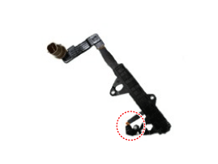

# Kia Sportage: Sensor de Temperatura do Óleo de Transaxle: Descrição e Operação

[Home](../../index.md) / [Manual de Serviço e Reparo do Kia Sportage SL](../sportage-482.md) / [Sistema de Transaxle Automático](sportage-683.md) / [Sistema de Controle de Transaxle Automático](sportage-704.md) / Sensor de Temperatura do Óleo de Transaxle: Descrição e Operação

## Descrição

O sensor de temperatura do óleo de transaxle monitora a temperatura do fluido de transmissão automática e transmite as leituras para o MCT. É um sensor NTC (Coeficiente Termal Negativo) cuja resistência tem uma relação inversamente proporcional com o nível de temperatura. Os dados produzidos por este sensor são utilizados para identificar as zonas de ativação e desativação do travamento da embreagem nas faixas de temperatura baixa e alta, e para compensar os níveis de pressão hidráulica durante as trocas de marcha.

