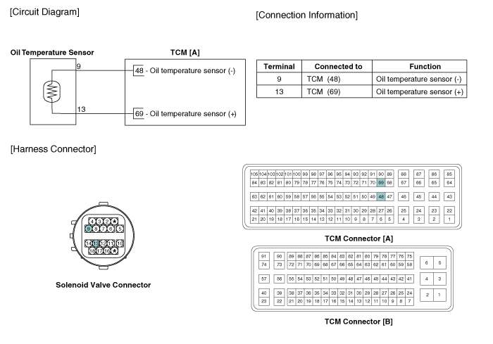

# Kia Sportage: Sensor de Temperatura do Óleo da Transaxle: Diagramas Schematicos

[Home](../../index.md) / [Manual de Serviço e Revisão do Kia Sportage SL](../sportage-482.md) / [Sistema de Transaxle Automático](sportage-683.md) / [Sistema de Controle do Transaxle Automático](sportage-704.md) / Diagramas Schematicos do Sensor de Temperatura do Óleo da Transaxle

## Diagrama Elétrico

