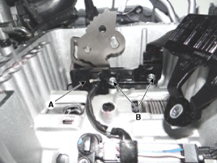
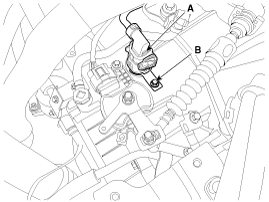

# Kia Sportage: Sensor de Temperatura do Óleo do Transaxle: Procedimentos de Reparo

[Home](../../index.md) / [Manual de Serviço e Reparo do Kia Sportage SL](../sportage-482.md) / [Sistema de Transaxle Automático](sportage-683.md) / [Sistema de Controle do Transaxle Automático](sportage-704.md) / Procedimentos de Reparo do Sensor de Temperatura do Óleo do Transaxle

## Inspeção

1. Desligue o interruptor de ignição.

2. Remova o dutamento de ar (A).

   

3. Remova a montagem do filtro de ar.

   | (1) | Desconecte o tubo de respiração (A) e o tubo do intensificador do potenteador de freio. |
   | --- | --- |

   ```
   Desconecte o tubo de admissão de ar e, em seguida, remova a montagem do filtro de ar (B).
   Torque de aperto
   Parafuso do anel de cinto:
   2,9 ~ 4,9 N.m (0,3 ~ 0,5 kgf.m, 2,2 ~ 3,6 lb-ft)
   Parafusos do montagem do filtro de ar:
   7,8 ~ 9,8 N.m (0,8 ~ 1,0 kgf.m, 5,8 ~ 7,2 lb-ft)
   ```

4. Desconecte o conector do solenoide (A).

   

5. Medida da resistência entre o terminal de sinal do sensor e o terminal de massa.

6. Verifique se a resistência está dentro da especificação.

## Remoção

1. Altere a alavanca de câmbio para a faixa "N".

2. Remova a montagem do corpo do valve.

   (Consulte "Corpo do Valve" no Sistema Hidráulico)

3. Desconecte o conector do sensor de velocidade de entrada e saída (A).

4. Aosso o parafuso principal do conector (B).

   ```
   Torque de aperto:
   9,8 ~ 11,8 N.m (1,0 ~ 1,2 kgf.m, 7,2 ~ 8,7 lb-ft)
   ```

   

5. Desconecte o conector do solenoide (A).

6. Remova a tira do conector do solenoide (B) após aosso o parafuso e, em seguida, remova o conector pressionando-o para baixo.

   

## Instalação

1. Instale na ordem inversa da remoção.

   > **Nota**
   >
   > - Adicione o Fluido do Transaxle Automático (ATF).
   > - (Consulte "Fluido" no Sistema Hidráulico nesta seção)
   > - Use um novo selo do corpo do valve (A).
