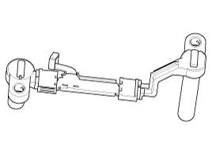

# Kia Sportage: Sensor de Velocidade de Entrada: Descrição e Operação

[Home](../../index.md) / [Manual de Serviço e Reparo do Kia Sportage SL](../sportage-482.md) / [Sistema de Transaxle Automático](sportage-683.md) / [Sistema de Controle do Transaxle Automático](sportage-704.md) / Sensor de Velocidade de Entrada: Descrição e Operação

## Descrição

O Sensor de Velocidade de Entrada é um componente vital que mede a taxa de rotação do eixo de entrada dentro da transmissão e transmite os valores para o TCM.

O sensor fornece dados de entrada críticos utilizados em controle de feedback, controle da couraça do embrague, controle da seleção de marcha, controle da pressão de linha, controle da pressão de ativação do embrague, e análise de falhas do sensor.

