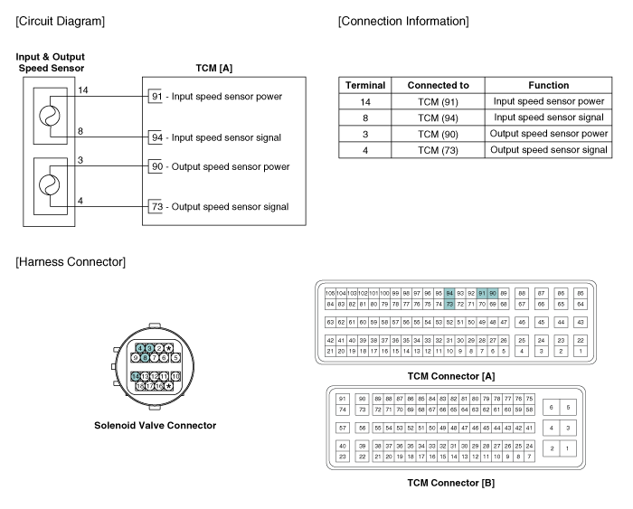

# Kia Sportage: Sensor de Velocidade de Entrada: Diagramas Schematicos

[Home](../../index.md) / [Manual de Serviço e Reparo do Kia Sportage SL](../sportage-482.md) / [Sistema de Transaxle Automático](sportage-683.md) / [Sistema de Controle de Transaxle Automático](sportage-704.md) / Diagramas Schematicos do Sensor de Velocidade de Entrada

## Diagrama Schematico

