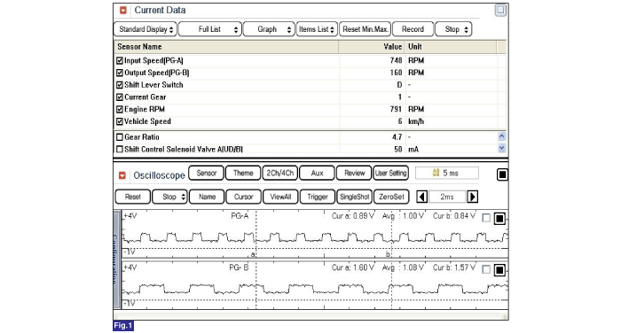
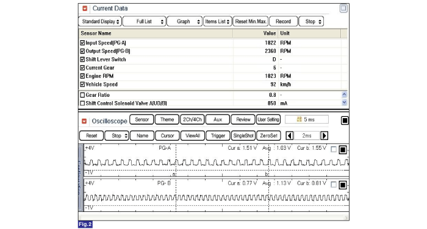

# Kia Sportage: Sensor de Velocidade de Entrada: Diagnóstico

[Home](../../index.md) / [Manual de Serviço e Reparo do Kia Sportage SL](../sportage-482.md) / [Sistema de Transaxle Automático](sportage-683.md) / [Sistema de Controle de Transaxle Automático](sportage-704.md) / Diagnóstico do Sensor de Velocidade de Entrada

## Forma da Sinal

Fig 1) Sensor de Velocidade de Entrada/ Saída em baixa velocidade

Fig 2) Sensor de Velocidade de Entrada/ Saída em alta velocidade
