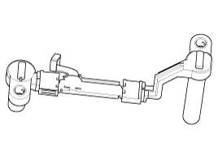

# Kia Sportage: Sensor de Velocidade de Saída: Descrição e Operação

[Home](../../index.md) / [Manual de Serviço e Reparo do Kia Sportage SL](../sportage-482.md) / [Sistema de Transaxle Automático](sportage-683.md) / [Sistema de Controle do Transaxle Automático](sportage-704.md) / Sensor de Velocidade de Saída: Descrição e Operação

## Descrição

O Sensor de Velocidade de Saída é um componente crucial que mede a
taxa de rotação do eixo do turbina e do eixo de saída da transmissão e
transmite as leituras para o TCM.

O sensor fornece dados de entrada críticos utilizados em
controle de feedback, controle do clutch amortecedor, controle da seleção de marcha, controle da pressão da linha, controle da pressão de ativação do clutch, e análise de falhas do sensor.

