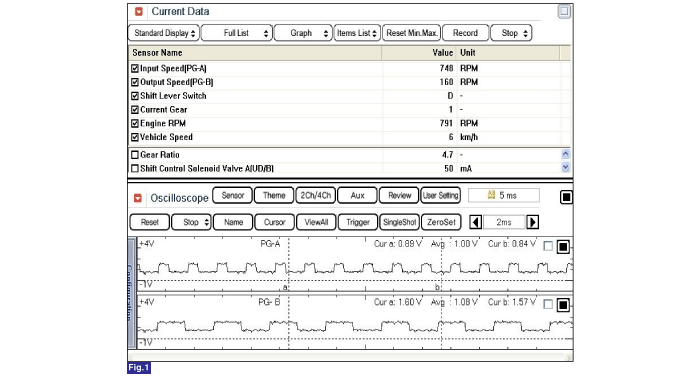
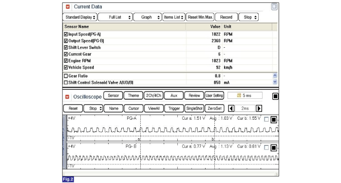

# Kia Sportage: Troubleshooting do Sensor de Velocidade de Saída

[Home](../../index.md) / [Manual de Serviço e Reparo do Kia Sportage SL](../sportage-482.md) / [Sistema de Transaxle Automático](sportage-683.md) / [Sistema de Controle do Transaxle Automático](sportage-704.md) / Troubleshooting do Sensor de Velocidade de Saída

## Forma de Sinal

Fig 1) Sensor de entrada/saída em baixa velocidade

Fig 2) Sensor de entrada/saída em alta velocidade
