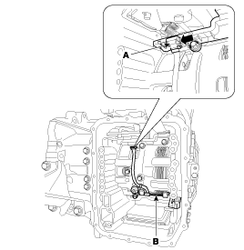

# Kia Sportage: Sensor de Velocidade de Saída: Procedimentos de Reparo

[Home](../../index.md) / [Manual de Serviço e Reparo do Kia Sportage SL](../sportage-482.md) / [Sistema de Transaxle Automático](sportage-683.md) / [Sistema de Controle de Transaxle Automático](sportage-704.md) / Procedimentos de Reparo do Sensor de Velocidade de Saída

## Inspeção

1. Verifique o sinal de onda do sensor de velocidade de entrada e saída usando o GDS.

   ```
   Especificação: Consulte a seção "Sinal de Onda".
   ```

## Remoção

1. Remova a montagem do corpo do valve.

   (Consulte o "Corpo do Valve" no Sistema Hidráulico desta seção)

2. Desconecte o conector do sensor de velocidade de entrada e saída (A) do cabo principal.

3. Remova o sensor de velocidade de entrada e saída (B) após remover as varetas (2 unidades).

   ```
   Torque de aperto:
   9,8 ~ 11,8 N.m (1,0 ~ 1,2 kgf.m, 7,2 ~ 8,7 lb-ft)
   ```

   

## Instalação

1. Instale na ordem inversa da remoção.

   > **Nota**
   >
   > - Adicione o Fluido do Transaxle Automático (ATF).
   > - (Consulte o "Fluido" no Sistema Hidráulico desta seção)
   > - Use a nova gasket do corpo do valve (A).
