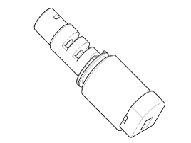

# Kia Sportage: Torque Converter Control Solenoid Valve (T/CON_VFS): Descrição e Operação

[Início](../../index.md) / [Manual de Serviço e Reparo do Kia Sportage SL](../sportage-482.md) / [Sistema de Transaxle Automático](sportage-683.md) / [Sistema de Controle do Transaxle Automático](sportage-704.md) / Torque Converter Control Solenoid Valve (T / CON_VFS): Descrição e Operação

## Descrição

O valve torque converter control solenoid (T/CON_VFS) está
fixado no corpo do valve. Este solenoide de força variável controla diretamente a pressão hidráulica dentro do torque converter.

