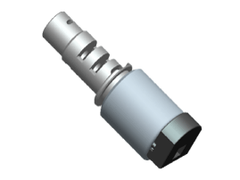

# Kia Sportage: 26 Solenoide de Valvula de Controle de Freio(26/B_VFS): Descrição e Operação

[Home](../../index.md) / [Manual de Serviço e Reparo do Kia Sportage SL](../sportage-482.md) / [Sistema de Transaxle Automático](sportage-683.md) / [Sistema de Controle do Transaxle Automático](sportage-704.md) / 26 Solenoide de Valvula de Controle de Freio(26 / B_VFS): Descrição e Operação

## Descrição

O solenoide de valvula de controle de freio 26 (26/B) está fixado ao corpo da valvula. Este solenoide de força variável controla diretamente a pressão hidráulica dentro do freio 26.

