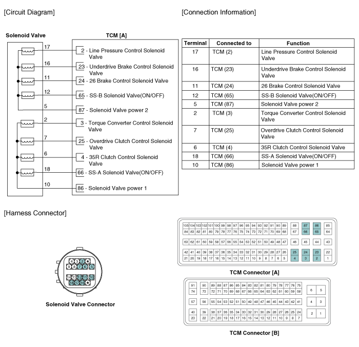

# Kia Sportage: 26 Solenoide Valvula de Controle de Freio(26/B_VFS): Diagramas Schematicos

[Home](../../index.md) / [Manual de Serviço e Reparo do Kia Sportage SL](../sportage-482.md) / [Sistema de Transaxle Automático](sportage-683.md) / [Sistema de Controle de Transaxle Automático](sportage-704.md) / 26 Solenoide Valvula de Controle de Freio(26 / B_VFS): Diagramas Schematicos

## Diagrama Elétrico

