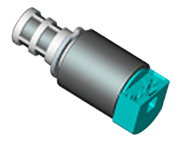

# Kia Sportage: Solenoide do Valvulário de Controle da Pressão da Linha: Descrição e Operação

[Home](../../index.md) / [Manual de Serviço e Reparo do Kia Sportage SL](../sportage-482.md) / [Sistema de Transaxle Automático](sportage-683.md) / [Sistema de Controle do Transaxle Automático](sportage-704.md) / Solenoide do Valvulário de Controle da Pressão da Linha: Descrição e Operação

## Descrição

o solenoide do valvulário de controle da pressão da linha está fixado ao corpo do valvulário. Este solenoide com força variável controla diretamente a pressão hidráulica dentro da linha de pressão.

