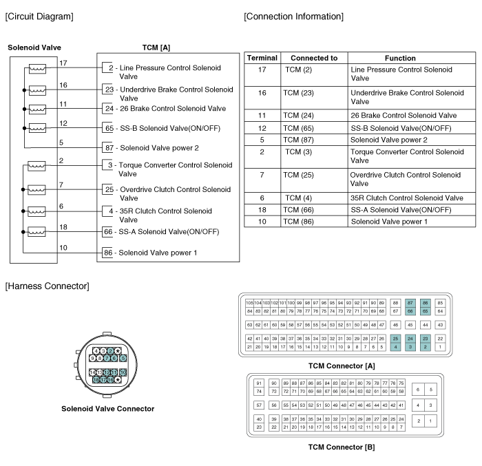

# Kia Sportage: Solenoide do Valvulino de Controle da Pressão da Linha: Diagramas Schematicos

[Home](../../index.md) / [Manual de Serviço e Reparo do Kia Sportage SL](../sportage-482.md) / [Sistema de Transaxle Automático](sportage-683.md) / [Sistema de Controle do Transaxle Automático](sportage-704.md) / Diagramas Schematicos do Solenoide do Valvulino de Controle da Pressão da Linha

## Diagrama Elétrico

