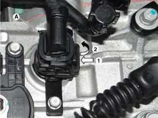

# Kia Sportage: Valvula de Válvula Solenoide de Controle da Pressão de Linha: Procedimentos de Reparo

[Home](../../index.md) / [Manual de Serviço e Reparo do Kia Sportage SL](../sportage-482.md) / [Sistema de Transaxle Automático](sportage-683.md) / [Sistema de Controle do Transaxle Automático](sportage-704.md) / Procedimentos de Reparo da Valvula de Válvula Solenoide de Controle da Pressão de Linha

## Inspeção

1. Desligue o interruptor de ignição.

2. Remova o dutamento de ar (A).

   

3. Remova a montagem do filtro de ar.

   | (1) | Desconecte o mangote do respirador (A) e o mangote do intensificador do potente de freio (B). |
   | --- | --- |

   ```
   Desconecte o mangote de admissão de ar e, em seguida, remova a montagem do filtro de ar (C).
   Torque de aperto do anel de ganchos:
   2,9 ~ 4,9 N.m (0,3 ~ 0,5 kgf.m, 2,2 ~ 3,6 lb-ft)
   Parafusos da montagem do filtro de ar:
   7,8 ~ 9,8 N.m (0,8 ~ 1,0 kgf.m, 5,8 ~ 7,2 lb-ft)
   ```

4. Desconecte o conector do solenoide (A).

   

5. Mede a resistência entre o terminal do sinal do sensor e o terminal da massa.

6. Verifique se a resistência está dentro da especificação.

## Remoção

> **Nota**
>
> - Substituir uma válvula solenoide on/off (SS-A, SS-B) não
exige ajuste adicional da pressão hidráulica; no entanto, a pressão hidráulica
precisará ser ajustada após a substituição da valvula VFS solenoide.
Se substituir a valvula VFS solenoide; também substitua a montagem da valvula.
> - (Consulte "Montagem da Valvula" no Sistema Hidráulico deste grupo)
