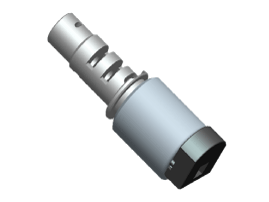

# Kia Sportage: 35R Clutch Control Solenoid Valve(35R/C_VFS): Descrição e Operação

[Home](../../index.md) / [Manual de Serviço e Reparo do Kia Sportage SL](../sportage-482.md) / [Sistema de Transaxle Automático](sportage-683.md) / [Sistema de Controle do Transaxle Automático](sportage-704.md) / 35R Clutch Control Solenoid Valve(35R / C_VFS): Descrição e Operação

## Descrição

O solenóide de válvula de controle do freio 35R (35R/C) está fixado ao corpo da válvula. Esta válvula solenóide de força variável controla diretamente a pressão hidráulica dentro do freio 35R.

