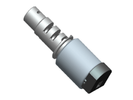

# Kia Sportage: Solenoide de Valvula de Controle do Freio em Sobrecarga (UD/B_VFS): Descrição e Operação

[Início](../../index.md) / [Manual de Serviço e Reparo do Kia Sportage SL](../sportage-482.md) / [Sistema de Transaxle Automático](sportage-683.md) / [Sistema de Controle do Transaxle Automático](sportage-704.md) / Solenoide de Valvula de Controle do Freio em Sobrecarga (UD / B_VFS): Descrição e Operação

## Descrição

O solenoide de valvula de controle do freio em sobrecarga (UD/B) está fixado ao corpo da valvula. Este solenoide com força variável controla diretamente a pressão hidráulica dentro do freio em sobrecarga.

