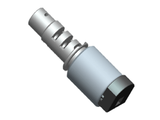

# Kia Sportage: Valvula de Solenoide de Controle da Cofre do Overdrive (OD/C_VFS): Descrição e Operação

[Início](../../index.md) / [Manual de Serviço e Reparo do Kia Sportage SL](../sportage-482.md) / [Sistema de Transaxle Automático](sportage-683.md) / [Sistema de Controle do Transaxle Automático](sportage-704.md) / Valvula de Solenoide de Controle da Cofre do Overdrive (OD / C_VFS): Descrição e Operação

## Descrição

O solenoide de controle da cofre do overdrive (OD/C) está fixado ao corpo do valve. Este solenoide de força variável controla diretamente a pressão hidráulica dentro da cofre do overdrive.

