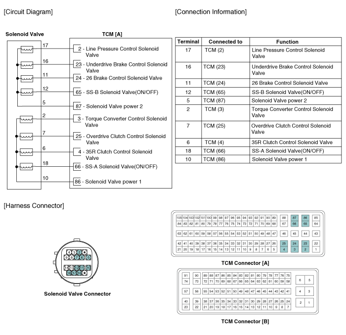

# Kia Sportage: Valvula de Circuito de Solenoide de Cofre de Overdrive Clutch(OD/C_VFS): Diagramas Schematicos

[Home](../../index.md) / [Manual de Serviço e Reparo do Kia Sportage SL](../sportage-482.md) / [Sistema de Transaxle Automático](sportage-683.md) / [Sistema de Controle do Transaxle Automático](sportage-704.md) / Valvula de Circuito de Solenoide de Cofre de Overdrive Clutch(OD / C_VFS): Diagramas Schematicos

## Diagrama Schematico

