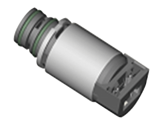

# Kia Sportage: SS-A Valvula Soleneida (Ligado/Desligado): Descrição e Operação

[Home](../../index.md) / [Manual de Serviço e Reparo do Kia Sportage SL](../sportage-482.md) / [Sistema de Transaxle Automático](sportage-683.md) / [Sistema de Controle do Transaxle Automático](sportage-704.md) / SS-A Valvula Soleneida (Ligado/Desligado): Descrição e Operação

## Descrição

A valvula soleneida SS-A está fixada no corpo da valvula e é uma valvula soleneida de ligado/desligado usada para mudar as marchas.

A valvula soleneida SS-A (Ligado/Desligado) está instalada no corpo da valvula.

