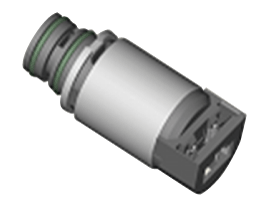

# Kia Sportage: SS-B Valvula de Válvula Magnética (Liga/Desliga): Descrição e Operação

[Home](../../index.md) / [Manual de Serviço e Reparo do Kia Sportage SL](../sportage-482.md) / [Sistema de Transaxle Automático](sportage-683.md) / [Sistema de Controle do Transaxle Automático](sportage-704.md) / SS-B Valvula de Válvula Magnética (Liga/Desliga): Descrição e Operação

## Descrição

A valvula de válvula magnética SS-B está fixada no corpo da valvula e é uma valvula magnética liga/desliga usada para mudar as marchas.

A valvula de válvula magnética SS-B (Liga/Desliga) está instalada no corpo da valvula.

