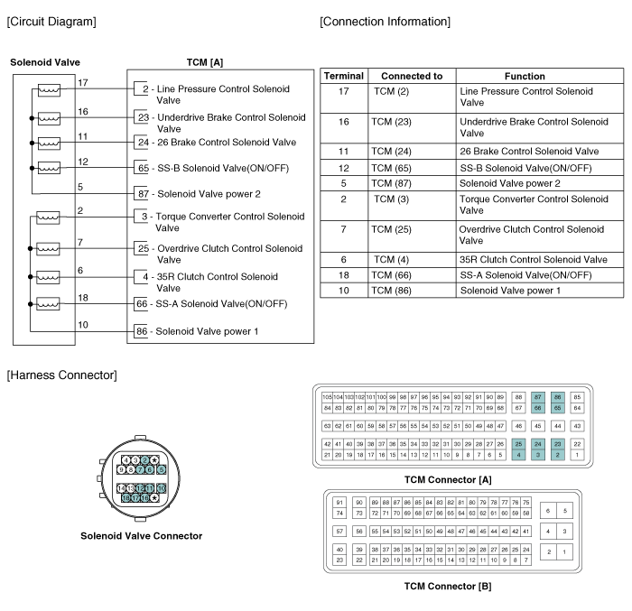

# Kia Sportage: SS-B Valvula de Válvula Soleneide (Ligado/Desligado): Diagramas Schematicos

[Home](../../index.md) / [Manual de Serviço e Reparo do Kia Sportage SL](../sportage-482.md) / [Sistema de Transaxle Automático](sportage-683.md) / [Sistema de Controle de Transaxle Automático](sportage-704.md) / Valvula de Válvula Soleneide (Ligado / Desligado): Diagramas Schematicos

## Diagrama Schematico

