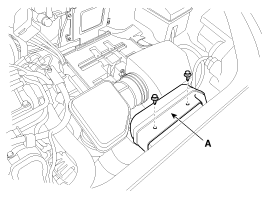
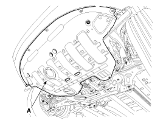
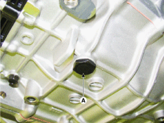
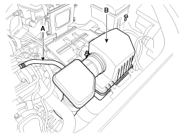
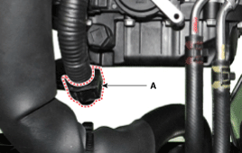
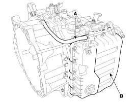
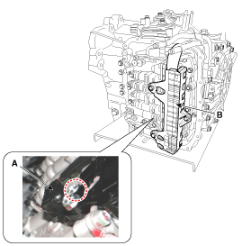
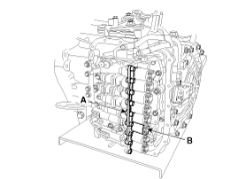

# Kia Sportage: SS-B Valvula de Válvula Soleneide (ON/OFF): Procedimentos de Reparo

[Home](../../index.md) / [Manual de Serviço e Reparo do Kia Sportage SL](../sportage-482.md) / [Sistema de Transaxle Automático](sportage-683.md) / [Sistema de Controle do Transaxle Automático](sportage-704.md) / Valvula de Válvula Soleneide SS-B (ON / OFF): Procedimentos de Reparo

## Inspeção

1. Desligue o interruptor de ignição.

2. Remova o dutamento de ar (A).

   

3. Remova a montagem do filtro de ar.

   | (1) | Desconecte o tubo de respiração (A) e o tubo do intensificador do potenteador de freio (B). |
   | --- | --- |

   ```
   Desconecte o tubo de admissão de ar e, em seguida, remova a montagem do filtro de ar (B).
   Torque de aperto:
   Parafuso do tubo de clamping:
   2,9 ~ 4,9 N.m (0,3 ~ 0,5 kgf.m, 2,2 ~ 3,6 lb-ft)
   Parafusos da montagem do filtro de ar:
   7,8 ~ 9,8 N.m (0,8 ~ 1,0 kgf.m, 5,8 ~ 7,2 lb-ft)
   ```

4. Desconecte o conector da válvula soleneide (A).

   

5. Medida da resistência entre o terminal do sinal do sensor e o terminal da massa.

6. Verifique se a resistência está dentro da especificação.

## Remoção

1. Remova a cobertura inferior (A).

   ```
   Torque de aperto:
   19,6 ~ 24,5 N.m (2,0 ~ 2,5 kgf.m, 14,5 ~ 18,1 lb-ft)
   ```

   

2. Remova a tampa de descarga (A) e derrame completamente a ATF e, em seguida, reinstale a tampa de descarga.

   ```
   Torque de aperto:
   33,3 ~ 43,1 N.m (3,4 ~ 4,4 kgf.m, 24,6 ~ 31,8 lb-ft)
   ```

   

   > **Nota**
   >
   > - É necessário substituir a borracha de vedação quando a tampa de descarga for instalada.

3. Remova o dutamento de ar (A).

   

4. Remova a montagem do filtro de ar.

   ```
   Torque de aperto
   Parafuso do tubo de clamping:
   2,9 ~ 4,9 N.m (0,3 ~ 0,5 kgf.m, 2,2 ~ 3,6 lb-ft)
   Parafusos da montagem do filtro de ar:
   7,8 ~ 9,8 N.m (0,8 ~ 1,0 kgf.m, 5,8 ~ 7,2 lb-ft)
   ```

   

5. Desconecte o gancho (A) da tampa do corpo da válvula.

   

6. Remova o tubo de respiração do filtro de ar (A).

7. Remova a tampa do corpo da válvula (B).

   ```
   Torque de aperto:
   13,7 ~ 15,7 N.m (1,4 ~ 1,6 kgf.m, 10,1 ~ 11,6 lb-ft)
   ```

   

8. Desconecte o conector da válvula soleneide (B) e o sensor de temperatura do óleo (A).

   

9. Remova a válvula soleneide (B) após remover o suporte da válvula (A).

   ```
   Torque de aperto:
   9,8 ~ 11,8 N.m (1,0 ~ 1,2 kgf.m, 7,2 ~ 8,7 lb-ft)
   ```

   

## Instalação

1. A instalação é o contrário da remoção.

   > **Observação**
   >
   > - Durante a instalação, aplique a ATF ou vaselina branca no anel elástico (A) para evitar danos.
   > - Utilize um novo selo para o corpo do valveado (A).
   > - Adicione fluido de transmissão automática.
   > - (Consulte "Fluido" no Sistema Hidráulico deste grupo)
   > - Realize o aprendizado do módulo de controle da transmissão (TCM) após a substituição do válvulo solenoide para prevenir uma resposta lenta da transmissão, aceleração intermitente e arranque intermitente.
   > - (Consulte "Procedimentos de reparo" no Sistema de Controle de Transmissão Automática deste grupo)
