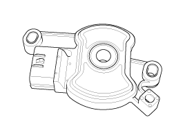

# Kia Sportage: Interruptor de Inibição: Descrição e Operação

[Home](../../index.md) / [Manual de Serviço e Reparo do Kia Sportage SL](../sportage-482.md) / [Sistema de Transaxle Automático](sportage-683.md) / [Sistema de Controle do Transaxle Automático](sportage-704.md) / Interruptor de Inibição: Descrição e Operação

## Descrição

O Interruptor de Inibição monitora a posição do manípulo (P, R, N, D) e é usado para controlar as sinais de engrenagem selecionada.

