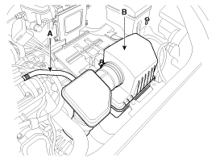
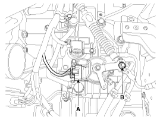
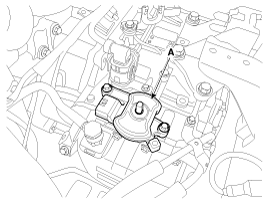
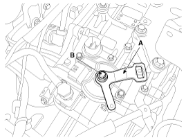
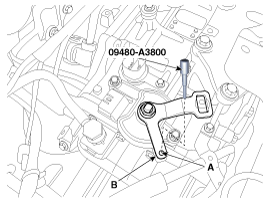
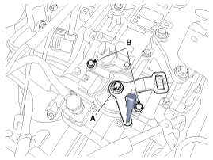
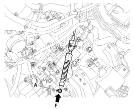

# Kia Sportage: Interruptor de Inibição: Procedimentos de Reparo

[Home](../../index.md) / [Manual de Serviço e Reparo do Kia Sportage SL](../sportage-482.md) / [Sistema de Transaxle Automático](sportage-683.md) / [Sistema de Controle do Transaxle Automático](sportage-704.md) / Procedimentos de Reparo do Interruptor de Inibição

## Inspeção

> **Nota**
>
> - Verifique com cuidado as conexões para ver se estão soltas, com mau contato, dobradas, corroídas, contaminadas, deterioradas ou danificadas.

Inspeção da Circuito de Energia

1. Desconecte a conexão do Interruptor de Inibição.

2. Chave do Ignição "ON" & Motor "OFF".

3. Medir a tensão entre a fonte de energia e o chassi no circuito de inibição.

   ```
   Especificação : Aproximadamente 12V
   ```

Inspeção do Circuito de Sinal

1. Conecte a conexão do Interruptor de Inibição.

2. Chave do Ignição "ON" & Motor "OFF".

3. Medir as tensões entre cada terminal e o chassi de chassi durante a mudança da alavanca de marcha "P, R, N, D".

   ```
   Especificação : Ver tabela de códigos de sinal abaixo
   ```

   Tabela de Códigos de Sinal

   | ? | P | P-R | R | R-N | N | N-D | D |
   | --- | --- | --- | --- | --- | --- | --- | --- |
   | Sinal "1" | 12V | 12V | 0 | 0 | 0 | 0 | 0 |
   | Sinal "2" | 0 | 12V | 12V | 12V | 0 | 0 | 0 |
   | Sinal "3" | 0 | 0 | 0 | 12V | 12V | 12V | 0 |
   | Sinal "4" | 0 | 0 | 0 | 0 | 0 | 12V | 12V |

## Remoção

1. Coloque a alavanca de marcha no posição "N".

2. Remova o dutamento de ar (A).

   

3. Remova a montagem do filtro de ar.

   | (1) | Desconecte o mangote do respirador (A) e o mangote do intensificador do potente do freio (B). |
   | --- | --- |

   | (2) | Desconecte o mangote de admissão de ar e, em seguida, remova a montagem do filtro de ar (B). |
   | --- | --- |

   

4. Remova o sistema de carregamento e a gaveta do carregador.

   (Consulte o "Sistema de carregamento" no grupo EE.)

5. Desconecte a conexão do interruptor de inibição (A).

6. Remova o parafuso de montagem da alavanca manual (B).

   

7. Remova a alavanca manual de controle (B) e a borracha após a remoção do parafuso (A).

   

8. Remova o interruptor de inibição (A) após a remoção das parafusos (2 unidades).

   

## Instalação

1. Verifique se a alavanca de câmbio está no posição "N"

2. Instale o interruptor de inibidor (A).

   > **Observação**
   >
   > - Ajuste os parafusos de montagem do interruptor de inibidor levemente para permitir ajustes necessários.

   

3. Instale o lembrete manual (A).

   > **Observação**
   >
   > - Ajuste levemente a rosca do lembrete manual (B) para permitir ajustes necessários.

   

4. Alinhe o orifício (A) no lembrete manual com o orifício "N" (B) no interruptor de inibidor e, em seguida, insira a guia do interruptor de inibidor SST (09480-A3800).

   

5. Ajuste os parafusos (A) e as varetas (B) com a torção especificada.

   ```
   Torção de aperto:
   A : 17,7 ~ 24,5 N.m (1,8 ~ 2,5 kgf.m, 13,0 ~ 18,1 lb-ft)
   B : 9,8 ~ 11,8 N.m (1,0 ~ 1,2 kgf.m, 7,2 ~ 8,7 lb-ft)
   ```

   

6. Remova o SST (09480-A3800) do orifício.

7. Conecte o conector do interruptor de inibidor (A).

8. Instale o cabo de câmbio ajustando a rosca (B).

   > **Observação**
   >
   > - Ajuste levemente a rosca de montagem do cabo de câmbio (B) para permitir ajustes necessários.

   

9. Empurre o cabo de câmbio até a seta "F" para eliminar o espaço livre e, em seguida, ajuste a rosca (A) com a torção especificada.

   ```
   Torção de aperto:
   9,8 ~ 14,7 N.m (1,0 ~ 1,4 kgf.m, 7,2 ~ 10,8 lb-ft)
   ```

   

10. Instale a bateria e a gaveta da bateria.

    (Consulte o "Sistema de carregamento" no grupo EE.)

11. Instale a montagem do filtro de ar.

    | (1) | Conecte a mangueira de respiração (A) e a mangueira intensificadora do potenteador de freio (B). |
    | --- | --- |

    ```
    Conecte a mangueira de entrada de ar e, em seguida, remova a montagem do filtro de ar (B).
    Torção de aperto
    Mangueira de respiração:
    2,9 ~ 4,9 N.m (0,3 ~ 0,5 kgf.m, 2,2 ~ 3,6 lb-ft)
    Parafusos da montagem do filtro de ar:
    7,8 ~ 9,8 N.m (0,8 ~ 1,0 kgf.m, 5,8 ~ 7,2 lb-ft)
    ```

12. Instale o dutamento de ar (A).

   
