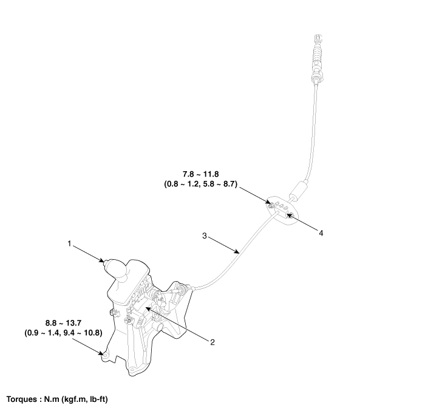

# Kia Sportage: Manivela de Mudança: Componentes e Localização

[Home](../../index.md) / [Manual de Serviço e Reparo do Kia Sportage SL](../sportage-482.md) / [Sistema de Transaxle Automático](sportage-683.md) / [Sistema de Controle do Transaxle Automático](sportage-704.md) / Manivela de Mudança: Componentes e Localização

## Componentes

| 1. Encaixe e cobertores da manivela de mudança 2. Encaixe da manivela de mudança 3. Envelope da corrente de mudança | 4. Suporte da corrente 5. Suporte do envelope da corrente |
| --- | --- |
