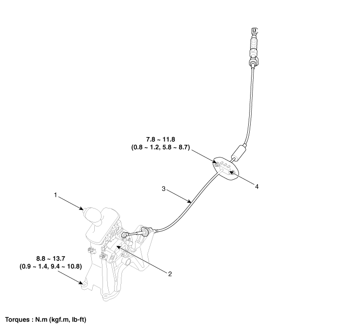

# Cinto de Mudança — Componentes e localização

[Home](../../index.md) / [Manual de Serviço e Reparo](../sportage-482.md) / [Sistema de Transaxle Automático](sportage-683.md) / [Sistema de Controle do Transaxle Automático](sportage-704.md) / Componentes e localização

## Diagrama

## Legenda

| Nº | Componente |
| --- | --- |
| 1 | Cabeça e cobertores do comando de marcha |
| 2 | Comando de marcha |
| 3 | Cinto de comando |
| 4 | Retenção do cinto |
