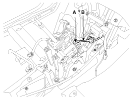
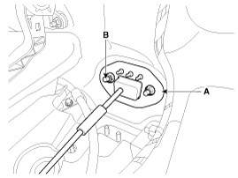
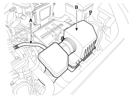

# Kia Sportage: Câmbio Manual: Procedimentos de Reparo

[Home](../../index.md) / [Manual de Serviço e Reparo do Kia Sportage SL](../sportage-482.md) / [Sistema de Transmissão Automática](sportage-683.md) / [Sistema de Controle da Transmissão Automática](sportage-704.md) / Procedimentos de Reparo do Câmbio Manual

## Inspeção

1. Verifique o dano e a operação do cabo de controle.

2. Verifique o dano da capa.

3. Verifique o dano e a corrosão do suporte.

4. Verifique o dano ou a debilidade da mola.

## Remoção

1. Remova a montagem do painel central.

   (Consulte "Interior (console)" no grupo BD.)

2. Remova o clip (A) e, em seguida, remova o cabo de câmbio (B).

   

3. Remova a montagem do cabo de câmbio na viatura após remover os parafusos (B) e o retenente (A).

   ```
   Torque de aperto:
   7,8 ~ 11,8 N.m (0,8 ~ 1,2 kgf.m, 5,8 ~ 8,7 lb-ft)
   ```

   

4. Remova o dutamento (A).

   

5. Remova a montagem do filtro de ar.

   ```
   Torque de aperto
   Parafuso do elástico de amarração:
   2,9 ~ 4,9 N.m (0,3 ~ 0,5 kgf.m, 2,2 ~ 3,6 lb-ft)
   Parafusos da montagem do filtro de ar:
   7,8 ~ 9,8 N.m (0,8 ~ 1,0 kgf.m, 5,8 ~ 7,2 lb-ft)
   ```

   

6. Remova a bateria e a prateleira da bateria.

   (Consulte "Sistema de carregamento" no grupo EE.)

7. Remova o cabo de câmbio (A).

   ```
   Desloque o parafuso (B).
   Torque de aperto:
   9,8 ~ 13,7 N.m (1,0 ~ 1,4 kgf.m, 7,2 ~ 10,1 lb-ft)
   ```

   | (2) | Faça o clip de liberação (C) e, em seguida, remova o cabo de câmbio (A) e o clip (C) do suporte. Não reutilize o clip (C). |
   | --- | --- |
   | Não reutilize o clip (C). | |

8. Remova o cabo de câmbio dentro do cabine.

## Instalação

> **Nota**
>
> - Ao instalar, coloque os leva da alavanca de câmbio do lado do ambiente e da alavanca T/M na posição "N".

1. Instale na ordem inversa da remoção.
